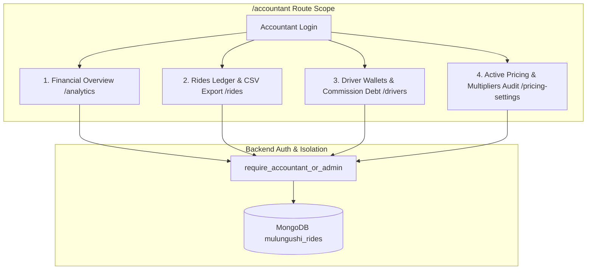

# 📊 Accountant Dashboard - Implementation Runbook & Architectural Specification

> **Document Version**: 1.0.0  
> **Target Branch**: `Mapbox` / `SYNCHRONIZATION`  
> **Status**: Ready for Implementation  
> **Classification**: Isolated Financial Subsystem (Zero Core Regression)

---

## 🔒 1. Strict Locked Modules & Zero-Regression Policy

Before executing any step in this runbook, review the non-negotiable workspace constraints:

1. **Ride Lifecycle State Machine is STRICTLY LOCKED**:
   - `request_ride`, `accept_ride`, `driver_arrived`, `start_ride`, `complete_ride`, `cancel_ride` must **NEVER** be modified.
   - Matching logic, active driver tracking, and ride state transitions must remain 100% untouched.
2. **Driver UI & Map Engine are STRICTLY LOCKED**:
   - `DriverDashboard.jsx`, `RideRequestPage.jsx`, `RouteEngine.jsx`, `RouteRenderer.jsx`, `PlatformMap.jsx`, `CameraEngine.jsx` must **NEVER** be modified.
3. **Additive & Cloned Architecture**:
   - The Accountant Dashboard is built **strictly by cloning existing working Admin analytics, ledger, and settlement views** and wrapping them in an isolated `/accountant` route namespace.

---

## 🏛️ 2. High-Level Architecture & Persona Scope

The Accountant persona requires comprehensive financial auditing, ride transaction logs, and driver commission settlement tools without access to destructive developer actions or user management.



### 📋 Role Capability Matrix:
| Feature / Action | Admin / Super Admin | Accountant | Student / Driver |
| :--- | :---: | :---: | :---: |
| View Gross Volume & Commission Profit Trends | ✅ | ✅ | ❌ |
| Search & Audit Ride Transaction Records | ✅ | ✅ | ❌ |
| Export Transaction Ledger (CSV) | ✅ | ✅ | ❌ |
| Record Driver Commission Remittance (Settle Debt) | ✅ | ✅ | ❌ |
| View Active Pricing & Multipliers Configuration | ✅ | ✅ (Read-Only) | ❌ |
| Edit Global Pricing & Base Fare Settings | ✅ | ❌ (View Only) | ❌ |
| Delete Users, Create Admins, or Modify Roles | ✅ | ❌ (Forbidden) | ❌ |
| Broadcast Push Notifications to Campus | ✅ | ❌ (Forbidden) | ❌ |
| View Sentry Bug Reports & Developer Errors | ✅ | ❌ (Forbidden) | ❌ |

---

## ⚙️ 3. Backend Implementation Steps (`backend/server.py`)

### Step 3.1: Add `ACCOUNTANT` to `UserRole` Enum
Locate `class UserRole(str, Enum):` around **line 267** in `backend/server.py`:

```python
class UserRole(str, Enum):
    STUDENT = "student"
    LECTURER = "lecturer"
    DRIVER = "driver"
    ADMIN = "admin"
    SUPER_ADMIN = "super_admin"
    ACCOUNTANT = "accountant"  # <-- ADD THIS LINE
```

---

### Step 3.2: Create `require_accountant_or_admin` Dependency
Locate `async def require_admin` around **line 732** in `backend/server.py` and add the dual-role guard:

```python
async def require_accountant_or_admin(user: dict = Depends(get_current_user)) -> dict:
    role = user.get("role", UserRole.STUDENT.value)
    if role not in [UserRole.ADMIN.value, UserRole.SUPER_ADMIN.value, UserRole.ACCOUNTANT.value]:
        raise HTTPException(status_code=403, detail="Accountant or Admin access required")
    return user
```

---

### Step 3.3: Authorize Accountant on Existing Financial Endpoints
Update the `dependencies=[Depends(...)]` on the following endpoints in `backend/server.py`:

1. **Stats & Analytics**:
   - `@api_router.get("/admin/stats", dependencies=[Depends(require_accountant_or_admin)])`
   - `@api_router.get("/admin/analytics", dependencies=[Depends(require_accountant_or_admin)])`
   - `@api_router.get("/admin/active-rides", dependencies=[Depends(require_accountant_or_admin)])`
2. **Rides Ledger**:
   - `@api_router.get("/admin/rides", dependencies=[Depends(require_accountant_or_admin)])`
3. **Driver Financials & Debt Settlements**:
   - `@api_router.get("/admin/drivers", dependencies=[Depends(require_accountant_or_admin)])`
   - `@api_router.post("/admin/drivers/{driver_id}/settle-commission", dependencies=[Depends(require_accountant_or_admin)])`
   - `@api_router.post("/admin/settlement/daily", dependencies=[Depends(require_accountant_or_admin)])`
4. **Pricing Settings Audit**:
   - `@api_router.get("/admin/pricing-settings", dependencies=[Depends(require_accountant_or_admin)])`

*(Note: Destructive operations such as `PUT /admin/pricing-settings`, `DELETE /admin/rides/{id}`, `DELETE /admin/users/{id}`, `POST /admin/create-admin` must retain `require_admin` or `require_super_admin`).*

---

## 🎨 4. Frontend Implementation Steps

### Step 4.1: Update `AuthContext.js` (`frontend/src/context/AuthContext.js`)
Add the `isAccountant` helper to the context value around **line 323**:

```javascript
const value = {
  user,
  setUser,
  updateUser,
  token,
  loading,
  driverProfile,
  setDriverProfile,
  api,
  fetchUser,
  login,
  register,
  registerDriver,
  signupDriver,
  logout,
  refreshDriverProfile,
  isAuthenticated: !!user,
  isDriver: user?.role === 'driver',
  isAdmin: user?.role === 'admin' || user?.role === 'super_admin',
  isSuperAdmin: user?.role === 'super_admin',
  isAccountant: user?.role === 'accountant', // <-- ADD THIS LINE
};
```

---

### Step 4.2: Update Navigation Bar (`frontend/src/components/layout/Layout.jsx`)
Add `accountantNavItems` and bind them when `user?.role === 'accountant'`:

```javascript
import { 
  ChartBar, UsersThree, Car, MapPin, Clock, 
  CurrencyCircleDollar, Gear, BugBeetle, Receipt, Wallet 
} from '@phosphor-icons/react';

// Define Accountant Specific Navigation
const accountantNavItems = [
  { to: '/accountant', icon: (props) => <ChartBar weight="duotone" {...props} />, label: 'Overview' },
  { to: '/accountant/ledger', icon: (props) => <Receipt weight="duotone" {...props} />, label: 'Rides Ledger' },
  { to: '/accountant/settlements', icon: (props) => <Wallet weight="duotone" {...props} />, label: 'Driver Wallets' },
  { to: '/accountant/pricing', icon: (props) => <CurrencyCircleDollar weight="duotone" {...props} />, label: 'Pricing Matrix' },
];

// Determine active nav items by role
const isAccountant = user?.role === 'accountant';
const navItems = isAccountant 
  ? accountantNavItems 
  : isAdmin 
  ? adminNavItems 
  : isDriver 
  ? driverNavItems 
  : studentNavItems;
```

---

### Step 4.3: Register Protected Routes (`frontend/src/App.js`)
Add the new accountant routes in `frontend/src/App.js`:

```javascript
import AccountantDashboard from "./pages/AccountantDashboard";
import AccountantLedgerPage from "./pages/AccountantLedgerPage";
import AccountantSettlementsPage from "./pages/AccountantSettlementsPage";
import AccountantPricingPage from "./pages/AccountantPricingPage";

// Inside Routes definition:
{/* Accountant Routes */}
<Route
  path="/accountant"
  element={
    <ProtectedRoute allowedRoles={['accountant', 'admin', 'super_admin']}>
      <AccountantDashboard />
    </ProtectedRoute>
  }
/>
<Route
  path="/accountant/ledger"
  element={
    <ProtectedRoute allowedRoles={['accountant', 'admin', 'super_admin']}>
      <AccountantLedgerPage />
    </ProtectedRoute>
  }
/>
<Route
  path="/accountant/settlements"
  element={
    <ProtectedRoute allowedRoles={['accountant', 'admin', 'super_admin']}>
      <AccountantSettlementsPage />
    </ProtectedRoute>
  }
/>
<Route
  path="/accountant/pricing"
  element={
    <ProtectedRoute allowedRoles={['accountant', 'admin', 'super_admin']}>
      <AccountantPricingPage />
    </ProtectedRoute>
  }
/>
```

---

## 💻 5. Complete Frontend Component Source Code

### 5.1. `AccountantDashboard.jsx` (`frontend/src/pages/AccountantDashboard.jsx`)
```jsx
import React, { useState, useEffect } from 'react';
import { CurrencyCircleDollar, TrendUp, Clock, Shield, CheckCircle } from '@phosphor-icons/react';
import { TrendingUp, Activity, FileSpreadsheet } from 'lucide-react';
import { GlassCard } from '../components/common/GlassComponents';
import { Layout } from '../components/layout/Layout';
import { useAuth } from '../context/AuthContext';
import { AdminDashboardSkeleton } from '../components/common/PageSkeletons';
import { AppCache } from '../utils/AppCache';
import {
  ResponsiveContainer,
  AreaChart,
  Area,
  XAxis,
  YAxis,
  CartesianGrid,
  Tooltip
} from 'recharts';

const AccountantDashboard = () => {
  const { api, user } = useAuth();
  const [stats, setStats] = useState(() => AppCache.get('accountant_stats') || null);
  const [analytics, setAnalytics] = useState(() => AppCache.get('accountant_analytics') || null);
  const [loading, setLoading] = useState(() => !AppCache.get('accountant_stats'));

  useEffect(() => {
    fetchData(Boolean(AppCache.get('accountant_stats')));
    const interval = setInterval(() => fetchData(true), 20000);
    return () => clearInterval(interval);
  }, []);

  const fetchData = async (isBackground = false) => {
    try {
      if (!isBackground && !stats) setLoading(true);
      const [statsRes, analyticsRes] = await Promise.allSettled([
        api.get('/admin/stats'),
        api.get('/admin/analytics')
      ]);

      if (statsRes.status === 'fulfilled' && statsRes.value?.data) {
        setStats(statsRes.value.data);
        AppCache.set('accountant_stats', statsRes.value.data);
      }
      if (analyticsRes.status === 'fulfilled' && analyticsRes.value?.data) {
        setAnalytics(analyticsRes.value.data);
        AppCache.set('accountant_analytics', analyticsRes.value.data);
      }
    } catch (error) {
      console.error('Error fetching accountant data:', error);
    } finally {
      if (!isBackground) setLoading(false);
    }
  };

  if (loading && !stats) {
    return (
      <Layout>
        <AdminDashboardSkeleton />
      </Layout>
    );
  }

  const revenueData = analytics?.revenue_trends && analytics.revenue_trends.length > 0
    ? analytics.revenue_trends
    : [{ date: 'Today', revenue: 0, gross_fare: 0, rides: 0 }];

  const totalGross = stats?.total_gross_volume || 0;
  const totalNet = stats?.total_revenue || 0;
  const driverPayouts = Math.max(0, totalGross - totalNet);

  return (
    <Layout>
      <div className="p-4 md:p-6 space-y-6 max-w-7xl mx-auto">
        {/* Header */}
        <div className="flex flex-col sm:flex-row sm:items-center sm:justify-between gap-4">
          <div>
            <h1 className="text-2xl md:text-3xl font-extrabold tracking-tight text-foreground">Accountant Financial Suite</h1>
            <p className="text-muted-foreground text-sm">Audited platform cash flows, commission ledger & driver settlements</p>
          </div>
          <div className="flex items-center gap-3">
            <div className="flex items-center gap-2 px-3 py-1.5 bg-gold/10 rounded-full border border-gold/20 text-gold text-xs font-semibold">
              <Shield weight="duotone" className="w-4 h-4" />
              Audited Financial Access
            </div>
          </div>
        </div>

        {/* Financial KPI Cards */}
        <div className="grid grid-cols-1 sm:grid-cols-2 lg:grid-cols-3 gap-4">
          {/* Gross Fare Volume */}
          <GlassCard className="p-5 border border-border/60" hover={false}>
            <div className="flex items-start justify-between">
              <div>
                <p className="text-muted-foreground text-xs font-medium uppercase tracking-wider mb-1">Gross Fare Volume</p>
                <p className="font-heading text-2xl md:text-3xl font-bold text-foreground">
                  ZMW {totalGross.toFixed(2)}
                </p>
                <p className="text-[11px] text-muted-foreground mt-1.5">100% total rider expenditure</p>
              </div>
              <div className="p-3 bg-blue-500/10 rounded-2xl border border-blue-500/20">
                <CurrencyCircleDollar weight="duotone" className="w-6 h-6 text-blue-500 shrink-0" />
              </div>
            </div>
          </GlassCard>

          {/* Platform Net Profit (Commission) */}
          <GlassCard className="p-5 border border-border/60" hover={false}>
            <div className="flex items-start justify-between">
              <div>
                <p className="text-muted-foreground text-xs font-medium uppercase tracking-wider mb-1">Platform Commission (10%)</p>
                <p className="font-heading text-2xl md:text-3xl font-bold text-gold">
                  ZMW {totalNet.toFixed(2)}
                </p>
                <p className="text-[11px] text-emerald-400 font-medium mt-1.5 flex items-center gap-1">
                  <TrendingUp className="w-3.5 h-3.5" />
                  Net platform retained revenue
                </p>
              </div>
              <div className="p-3 bg-gold/10 rounded-2xl border border-gold/20">
                <TrendUp weight="duotone" className="w-6 h-6 text-gold shrink-0" />
              </div>
            </div>
          </GlassCard>

          {/* Total Driver Payouts (90%) */}
          <GlassCard className="p-5 border border-border/60" hover={false}>
            <div className="flex items-start justify-between">
              <div>
                <p className="text-muted-foreground text-xs font-medium uppercase tracking-wider mb-1">Driver Earnings (90%)</p>
                <p className="font-heading text-2xl md:text-3xl font-bold text-emerald-400">
                  ZMW {driverPayouts.toFixed(2)}
                </p>
                <p className="text-[11px] text-muted-foreground mt-1.5">Disbursed/retained by active drivers</p>
              </div>
              <div className="p-3 bg-emerald-500/10 rounded-2xl border border-emerald-500/20">
                <CheckCircle weight="duotone" className="w-6 h-6 text-emerald-500 shrink-0" />
              </div>
            </div>
          </GlassCard>
        </div>

        {/* Revenue Trends Chart */}
        <GlassCard className="p-6 border border-border/60" hover={false}>
          <div className="flex items-center justify-between mb-6">
            <div>
              <h3 className="font-heading font-bold text-foreground flex items-center gap-2 text-base">
                <TrendingUp className="w-5 h-5 text-gold" />
                Revenue & Profit Trajectory
              </h3>
              <p className="text-xs text-muted-foreground mt-0.5">Daily audited platform profit volume</p>
            </div>
          </div>
          <div className="h-[280px] w-full">
            <ResponsiveContainer width="100%" height="100%">
              <AreaChart data={revenueData}>
                <defs>
                  <linearGradient id="colorRev" x1="0" y1="0" x2="0" y2="1">
                    <stop offset="5%" stopColor="#EAB308" stopOpacity={0.4} />
                    <stop offset="95%" stopColor="#EAB308" stopOpacity={0.0} />
                  </linearGradient>
                </defs>
                <CartesianGrid strokeDasharray="3 3" stroke="hsl(var(--border))" vertical={false} />
                <XAxis dataKey="date" stroke="hsl(var(--muted-foreground))" fontSize={11} />
                <YAxis stroke="hsl(var(--muted-foreground))" fontSize={11} tickFormatter={(val) => `K${val}`} />
                <Tooltip
                  contentStyle={{ backgroundColor: 'hsl(var(--card))', border: '1px solid hsl(var(--border))', borderRadius: '12px', color: 'hsl(var(--foreground))' }}
                  formatter={(val) => [`ZMW ${Number(val).toFixed(2)}`, 'Platform Profit']}
                />
                <Area type="monotone" dataKey="revenue" stroke="#EAB308" strokeWidth={2.5} fillOpacity={1} fill="url(#colorRev)" />
              </AreaChart>
            </ResponsiveContainer>
          </div>
        </GlassCard>
      </div>
    </Layout>
  );
};

export default AccountantDashboard;
```

---

### 5.2. `AccountantLedgerPage.jsx` with CSV Export (`frontend/src/pages/AccountantLedgerPage.jsx`)
```jsx
import React, { useState, useEffect, useMemo } from 'react';
import { Search, Calendar, Filter, Eye, Download, FileSpreadsheet, MapPin } from 'lucide-react';
import { GlassCard, StatusBadge, EmptyState } from '../components/common/GlassComponents';
import { Layout } from '../components/layout/Layout';
import { useAuth } from '../context/AuthContext';
import { AdminRidesSkeleton } from '../components/common/PageSkeletons';
import { AppCache } from '../utils/AppCache';
import { toast } from 'sonner';
import {
  Dialog,
  DialogContent,
  DialogHeader,
  DialogTitle,
} from '../components/ui/dialog';

const AccountantLedgerPage = () => {
  const { api } = useAuth();
  const [rides, setRides] = useState(() => AppCache.get('accountant_rides') || []);
  const [loading, setLoading] = useState(() => !AppCache.get('accountant_rides'));
  const [searchQuery, setSearchQuery] = useState('');
  const [statusFilter, setStatusFilter] = useState('all');
  const [selectedRide, setSelectedRide] = useState(null);

  useEffect(() => {
    fetchRides(Boolean(AppCache.get('accountant_rides')));
  }, []);

  const fetchRides = async (isBackground = false) => {
    try {
      if (!isBackground && rides.length === 0) setLoading(true);
      const res = await api.get('/admin/rides?limit=500');
      setRides(res.data);
      AppCache.set('accountant_rides', res.data);
    } catch (e) {
      toast.error('Failed to load transaction ledger');
    } finally {
      if (!isBackground) setLoading(false);
    }
  };

  const processedRides = useMemo(() => {
    return rides.filter(r => {
      const sName = (r.student?.name || '').toLowerCase();
      const dName = (r.driver?.user?.name || '').toLowerCase();
      const q = searchQuery.toLowerCase();
      const matchesSearch = sName.includes(q) || dName.includes(q) || (r.id && r.id.toLowerCase().includes(q));
      const matchesStatus = statusFilter === 'all' || r.status === statusFilter;
      return matchesSearch && matchesStatus;
    });
  }, [rides, searchQuery, statusFilter]);

  // Export to CSV Function
  const exportToCSV = () => {
    if (processedRides.length === 0) {
      toast.error('No transactions to export');
      return;
    }

    const headers = ['Transaction ID', 'Date', 'Passenger', 'Driver', 'Mode', 'Distance (km)', 'Gross Fare (ZMW)', 'Driver Earning (ZMW)', 'Platform Profit (ZMW)', 'Status'];
    const rows = processedRides.map(r => [
      r.id,
      r.created_at ? new Date(r.created_at).toISOString() : '',
      `"${r.student?.name || 'Passenger'}"`,
      `"${r.driver?.user?.name || 'Driver'}"`,
      r.ride_mode || 'shared',
      r.distance_km?.toFixed(2) || '0.00',
      r.fare?.toFixed(2) || '0.00',
      r.driver_earning?.toFixed(2) || (r.fare * 0.9).toFixed(2),
      (r.fare - (r.driver_earning || (r.fare * 0.9))).toFixed(2),
      r.status
    ]);

    const csvContent = 'data:text/csv;charset=utf-8,' + [headers.join(','), ...rows.map(e => e.join(','))].join('\n');
    const encodedUri = encodeURI(csvContent);
    const link = document.createElement('a');
    link.setAttribute('href', encodedUri);
    link.setAttribute('download', `JaeyRide_Ledger_${new Date().toISOString().slice(0, 10)}.csv`);
    document.body.appendChild(link);
    link.click();
    document.body.removeChild(link);
    toast.success('Ledger exported successfully!');
  };

  if (loading && rides.length === 0) {
    return (
      <Layout>
        <AdminRidesSkeleton />
      </Layout>
    );
  }

  return (
    <Layout>
      <div className="p-4 md:p-6 space-y-6 max-w-7xl mx-auto">
        <div className="flex flex-col sm:flex-row sm:items-center sm:justify-between gap-4">
          <div>
            <h1 className="text-2xl md:text-3xl font-extrabold tracking-tight text-foreground">Transaction & Rides Ledger</h1>
            <p className="text-muted-foreground text-sm">Granular financial records of all campus passenger trips</p>
          </div>
          <button
            onClick={exportToCSV}
            className="flex items-center gap-2 px-4 py-2.5 rounded-xl bg-gold text-zinc-950 font-bold hover:brightness-105 transition-all cursor-pointer shadow-md"
          >
            <Download className="w-4 h-4" />
            Export CSV
          </button>
        </div>

        {/* Filters */}
        <div className="flex flex-col sm:flex-row gap-4">
          <div className="relative flex-1">
            <Search className="w-5 h-5 absolute left-3.5 top-1/2 -translate-y-1/2 text-muted-foreground" />
            <input
              type="text"
              placeholder="Search by passenger, driver, or trip ID..."
              value={searchQuery}
              onChange={(e) => setSearchQuery(e.target.value)}
              className="w-full bg-card border border-border rounded-xl pl-11 pr-4 py-3 text-sm text-foreground focus:outline-none focus:border-gold"
            />
          </div>
          <select
            value={statusFilter}
            onChange={(e) => setStatusFilter(e.target.value)}
            className="bg-card border border-border rounded-xl px-4 py-3 text-sm text-foreground focus:outline-none"
          >
            <option value="all">All Trip Statuses</option>
            <option value="completed">Completed Only</option>
            <option value="cancelled">Cancelled Only</option>
          </select>
        </div>

        {/* Ledger Table */}
        <GlassCard className="overflow-hidden border border-border/60 p-0" hover={false}>
          <div className="overflow-x-auto">
            <table className="w-full text-left text-sm">
              <thead className="bg-muted/50 border-b border-border text-xs uppercase tracking-wider text-muted-foreground">
                <tr>
                  <th className="p-4">Date / ID</th>
                  <th className="p-4">Passenger</th>
                  <th className="p-4">Driver</th>
                  <th className="p-4">Mode</th>
                  <th className="p-4 text-right">Gross Fare</th>
                  <th className="p-4 text-right">Driver (90%)</th>
                  <th className="p-4 text-right">Profit (10%)</th>
                  <th className="p-4 text-center">Status</th>
                </tr>
              </thead>
              <tbody className="divide-y divide-border/40">
                {processedRides.map((ride) => {
                  const gross = ride.fare || 0;
                  const driverShare = ride.driver_earning || (gross * 0.9);
                  const commission = gross - driverShare;

                  return (
                    <tr key={ride.id} className="hover:bg-muted/30 transition-colors">
                      <td className="p-4 font-mono text-xs text-muted-foreground">
                        {ride.created_at ? new Date(ride.created_at).toLocaleDateString() : 'N/A'}
                        <div className="text-[10px] text-muted-foreground/60">{ride.id?.slice(0, 8)}...</div>
                      </td>
                      <td className="p-4 font-semibold text-foreground">{ride.student?.name || 'Passenger'}</td>
                      <td className="p-4 text-muted-foreground">{ride.driver?.user?.name || 'Driver'}</td>
                      <td className="p-4 capitalize text-xs">{ride.ride_mode || 'shared'}</td>
                      <td className="p-4 text-right font-bold text-foreground">K{gross.toFixed(2)}</td>
                      <td className="p-4 text-right text-emerald-400 font-medium">K{driverShare.toFixed(2)}</td>
                      <td className="p-4 text-right text-gold font-bold">K{commission.toFixed(2)}</td>
                      <td className="p-4 text-center">
                        <StatusBadge status={ride.status} />
                      </td>
                    </tr>
                  );
                })}
              </tbody>
            </table>
          </div>
        </GlassCard>
      </div>
    </Layout>
  );
};

export default AccountantLedgerPage;
```

---

### 5.3. `AccountantSettlementsPage.jsx` (`frontend/src/pages/AccountantSettlementsPage.jsx`)
```jsx
import React, { useState, useEffect } from 'react';
import { Search, Wallet, CheckCircle, AlertCircle, DollarSign } from 'lucide-react';
import { GlassCard, GlassInput, GoldButton } from '../components/common/GlassComponents';
import { Layout } from '../components/layout/Layout';
import { useAuth } from '../context/AuthContext';
import { toast } from 'sonner';
import {
  Dialog,
  DialogContent,
  DialogHeader,
  DialogTitle,
} from '../components/ui/dialog';

const AccountantSettlementsPage = () => {
  const { api } = useAuth();
  const [drivers, setDrivers] = useState([]);
  const [loading, setLoading] = useState(true);
  const [searchQuery, setSearchQuery] = useState('');
  
  // Settle Modal State
  const [settleModalOpen, setSettleModalOpen] = useState(false);
  const [targetDriver, setTargetDriver] = useState(null);
  const [settleAmount, setSettleAmount] = useState('');
  const [settleNotes, setSettleNotes] = useState('Physical Commission Settlement');
  const [isSubmitting, setIsSubmitting] = useState(false);

  useEffect(() => {
    fetchDrivers();
  }, []);

  const fetchDrivers = async () => {
    setLoading(true);
    try {
      const res = await api.get('/admin/drivers');
      setDrivers(res.data);
    } catch (e) {
      toast.error('Failed to load driver financial wallets');
    } finally {
      setLoading(false);
    }
  };

  const handleOpenSettle = (driver) => {
    setTargetDriver(driver);
    setSettleAmount(driver.wallet_balance ? Math.abs(driver.wallet_balance).toString() : '0');
    setSettleModalOpen(true);
  };

  const handleConfirmSettle = async (e) => {
    e.preventDefault();
    if (!targetDriver || !settleAmount || parseFloat(settleAmount) <= 0) {
      toast.error('Please enter a valid settlement amount');
      return;
    }

    setIsSubmitting(true);
    try {
      await api.post(`/admin/drivers/${targetDriver.id}/settle-commission`, {
        amount: parseFloat(settleAmount),
        notes: settleNotes
      });
      toast.success(`Commission debt settled for ${targetDriver.user?.name}`);
      setSettleModalOpen(false);
      fetchDrivers();
    } catch (error) {
      toast.error('Failed to settle commission');
    } finally {
      setIsSubmitting(false);
    }
  };

  const filteredDrivers = drivers.filter(d => {
    const name = (d.user?.name || '').toLowerCase();
    const phone = (d.user?.phone || '').toLowerCase();
    return name.includes(searchQuery.toLowerCase()) || phone.includes(searchQuery.toLowerCase());
  });

  return (
    <Layout>
      <div className="p-4 md:p-6 space-y-6 max-w-7xl mx-auto">
        <div>
          <h1 className="text-2xl md:text-3xl font-extrabold tracking-tight text-foreground">Driver Debt & Commission Settlements</h1>
          <p className="text-muted-foreground text-sm">Monitor driver debt wallets, K500 restriction limits & record cash remittances</p>
        </div>

        {/* Search */}
        <div className="relative">
          <Search className="w-5 h-5 absolute left-3.5 top-1/2 -translate-y-1/2 text-muted-foreground" />
          <input
            type="text"
            placeholder="Search driver by name or phone..."
            value={searchQuery}
            onChange={(e) => setSearchQuery(e.target.value)}
            className="w-full bg-card border border-border rounded-xl pl-11 pr-4 py-3 text-sm text-foreground focus:outline-none focus:border-gold"
          />
        </div>

        {/* Drivers Wallet Grid */}
        <div className="grid grid-cols-1 md:grid-cols-2 lg:grid-cols-3 gap-4">
          {filteredDrivers.map((driver) => {
            const debt = driver.wallet_balance || 0;
            const isRestricted = driver.wallet_status === 'restricted' || debt >= 500;

            return (
              <GlassCard key={driver.id} className="p-5 border border-border/60 flex flex-col justify-between" hover={false}>
                <div className="space-y-3">
                  <div className="flex items-start justify-between">
                    <div>
                      <h3 className="font-bold text-base text-foreground">{driver.user?.name || 'Driver'}</h3>
                      <p className="text-xs text-muted-foreground">{driver.user?.phone}</p>
                    </div>
                    <span className={`text-[11px] px-2.5 py-1 rounded-full font-bold uppercase ${
                      isRestricted ? 'bg-red-500/20 text-red-400 border border-red-500/30' : 'bg-emerald-500/10 text-emerald-400'
                    }`}>
                      {isRestricted ? 'Restricted' : 'Normal'}
                    </span>
                  </div>

                  <div className="p-3 bg-muted/40 rounded-xl space-y-1">
                    <p className="text-xs text-muted-foreground">Commission Debt Balance</p>
                    <p className={`text-xl font-heading font-bold ${isRestricted ? 'text-red-400' : 'text-foreground'}`}>
                      K{debt.toFixed(2)} <span className="text-xs text-muted-foreground font-normal">/ K500.00 Limit</span>
                    </p>
                  </div>
                </div>

                <div className="pt-4">
                  <button
                    onClick={() => handleOpenSettle(driver)}
                    className="w-full py-2.5 rounded-xl bg-gold/15 hover:bg-gold/25 border border-gold/30 text-gold font-bold text-xs flex items-center justify-center gap-2 cursor-pointer transition-colors"
                  >
                    <DollarSign className="w-4 h-4" />
                    Record Settlement
                  </button>
                </div>
              </GlassCard>
            );
          })}
        </div>

        {/* Settle Modal */}
        <Dialog open={settleModalOpen} onOpenChange={setSettleModalOpen}>
          <DialogContent className="bg-zinc-950 border-border text-foreground max-w-md">
            <DialogHeader>
              <DialogTitle className="text-lg font-bold">Record Commission Settlement</DialogTitle>
            </DialogHeader>
            <form onSubmit={handleConfirmSettle} className="space-y-4 pt-2">
              <div>
                <label className="block text-xs text-muted-foreground mb-1">Driver Name</label>
                <p className="text-sm font-bold text-white">{targetDriver?.user?.name}</p>
              </div>
              <div>
                <label className="block text-xs text-muted-foreground mb-1">Settlement Amount (ZMW)</label>
                <GlassInput
                  type="number"
                  step="0.5"
                  value={settleAmount}
                  onChange={(e) => setSettleAmount(e.target.value)}
                  required
                />
              </div>
              <div>
                <label className="block text-xs text-muted-foreground mb-1">Audit Notes</label>
                <GlassInput
                  type="text"
                  value={settleNotes}
                  onChange={(e) => setSettleNotes(e.target.value)}
                />
              </div>
              <GoldButton type="submit" loading={isSubmitting} className="w-full mt-4">
                Confirm & Clear Debt
              </GoldButton>
            </form>
          </DialogContent>
        </Dialog>
      </div>
    </Layout>
  );
};

export default AccountantSettlementsPage;
```

---

### 5.4. `AccountantPricingPage.jsx` (`frontend/src/pages/AccountantPricingPage.jsx`)
```jsx
import React, { useState, useEffect } from 'react';
import { Calculator, Shield } from 'lucide-react';
import { GlassCard } from '../components/common/GlassComponents';
import { Layout } from '../components/layout/Layout';
import { useAuth } from '../context/AuthContext';
import { toast } from 'sonner';

const AccountantPricingPage = () => {
  const { api } = useAuth();
  const [settings, setSettings] = useState(null);
  const [loading, setLoading] = useState(true);

  useEffect(() => {
    fetchSettings();
  }, []);

  const fetchSettings = async () => {
    try {
      const res = await api.get('/admin/pricing-settings');
      setSettings(res.data);
    } catch (e) {
      toast.error('Failed to load pricing matrix');
    } finally {
      setLoading(false);
    }
  };

  if (loading) {
    return <Layout><div className="p-8 text-center text-muted-foreground">Loading pricing matrix...</div></Layout>;
  }

  return (
    <Layout>
      <div className="p-4 md:p-6 space-y-6 max-w-5xl mx-auto">
        <div className="flex items-center justify-between">
          <div>
            <h1 className="text-2xl md:text-3xl font-extrabold tracking-tight text-foreground">Active Pricing Matrix (Audit View)</h1>
            <p className="text-muted-foreground text-sm">Read-only audit record of active platform rates and multipliers</p>
          </div>
          <div className="flex items-center gap-2 px-3 py-1 bg-muted rounded-full border border-border text-xs text-muted-foreground font-semibold">
            <Shield className="w-3.5 h-3.5 text-gold" />
            Audit Read-Only
          </div>
        </div>

        <div className="grid grid-cols-1 md:grid-cols-2 gap-4">
          <GlassCard className="p-5 border border-border/60" hover={false}>
            <h3 className="font-bold text-base text-foreground mb-4">Distance & Time Parameters</h3>
            <div className="space-y-3 text-sm">
              <div className="flex justify-between py-2 border-b border-border/40">
                <span className="text-muted-foreground">Base Starting Fare</span>
                <span className="font-bold text-foreground">K{settings?.base_fare?.toFixed(2)}</span>
              </div>
              <div className="flex justify-between py-2 border-b border-border/40">
                <span className="text-muted-foreground">Per Kilometer Rate</span>
                <span className="font-bold text-foreground">K{settings?.per_km_rate?.toFixed(2)} / km</span>
              </div>
              <div className="flex justify-between py-2 border-b border-border/40">
                <span className="text-muted-foreground">Minimum Fare Cap</span>
                <span className="font-bold text-foreground">K{settings?.minimum_fare?.toFixed(2)}</span>
              </div>
            </div>
          </GlassCard>

          <GlassCard className="p-5 border border-border/60" hover={false}>
            <h3 className="font-bold text-base text-foreground mb-4">Platform Commissions & Multipliers</h3>
            <div className="space-y-3 text-sm">
              <div className="flex justify-between py-2 border-b border-border/40">
                <span className="text-muted-foreground">Platform Commission Rate</span>
                <span className="font-bold text-gold">{((settings?.commission_rate ?? 0.10) * 100).toFixed(0)}%</span>
              </div>
              <div className="flex justify-between py-2 border-b border-border/40">
                <span className="text-muted-foreground">Private Ride Multiplier</span>
                <span className="font-bold text-foreground">{settings?.private_multiplier ?? 3.5}x</span>
              </div>
              <div className="flex justify-between py-2 border-b border-border/40">
                <span className="text-muted-foreground">Driver Debt Wallet Restriction Limit</span>
                <span className="font-bold text-red-400">K{settings?.max_commission_owed_limit?.toFixed(2) ?? '500.00'}</span>
              </div>
            </div>
          </GlassCard>
        </div>
      </div>
    </Layout>
  );
};

export default AccountantPricingPage;
```

---

## 🧪 6. Verification & Validation Protocol

After applying the changes in the other conversation:

1. **Verify Backend Syntax & Startup**:
   ```bash
   python -c "import server; print('Server imports successfully with UserRole.ACCOUNTANT')"
   ```
2. **Verify Frontend Build**:
   ```bash
   cd frontend && npm run build
   ```
3. **Login / Role Verification**:
   - Assign `role: "accountant"` to a test user in MongoDB.
   - Log in with accountant credentials.
   - Verify sidebar displays Overview, Rides Ledger, Driver Wallets, and Pricing Matrix.
   - Verify CSV export downloads correctly with accurate fare calculations.
4. **Zero-Regression Proof**:
   - Student Ride Request and Transit Stepper work with 0 errors.
   - Driver Dashboard displays live active trips without flicker.
