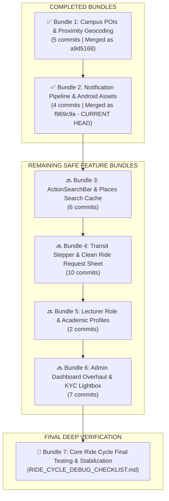

# 🗺️ STUDENT-RIDE: MASTER FEATURE MIGRATION ROADMAP

> **Branch Target**: Strictly `Mapbox-stable` (`origin/Mapbox-stable`)  
> **Workspace**: Strictly `C:\Users\Reaga\OneDrive\Documents\VS Codes\Projects\Mapbox stable`  
> **Baseline Commit**: `885a0b1` (*"perf(map): set camera flyTo speed 2x slower to smooth 4.8s glide"*)  
> **Verification Status**: ✅ **100% Commit Audit Passed (44 of 44 Total Commits Accounted For with ZERO Missing)**

---

## 📌 MASTER PIPELINE OVERVIEW

---

## 🟢 PART 1: COMPLETED FEATURE BUNDLES (ON MAPBOX-STABLE)

### ✅ Bundle 1: Campus POIs, Hostels & Proximity Geocoding (5 Commits)
* **Status**: `COMPLETED` *(Merged as commit `a9d5168`)*
* **Scope**: Landmark GeoJSON data, hostel POI color-coded category palette, sub-millisecond reverse geocoding snapping.
* **Commits**:
  * `e7bd22b` – *fix(map): Mapbox standard POI color palette, add Kafue hostel, fix Mweru hostel category, and enhance label typography*
  * `557020f` – *fix(map): remove rogue Kabwe hostel on campus and remove duplicate Kingdom hall Mulungushi*
  * `5ca041b` – *feat(map): apply category-matching text colors for POI landmark names with white/dark halo stroke*
  * `ea526f9` – *fix(map): render crisp white text and icons in dark mode with category palette in light mode*
  * `4ae566c` – *feat(geocoding): proximity landmark snapping and clean address formatting*

---

### ✅ Bundle 2: Notification Pipeline & Android Silhouette Drawables (4 Commits)
* **Status**: `COMPLETED (CURRENT HEAD: f969c9a)`
* **Scope**: Full VAPID web-push pipeline with auto-purging dead tokens, native FCM Android channels, hardware vibration signatures, and transparent white silhouette notification icons across all screen densities.
* **Commits**:
  * `7b61be1` – *docs: generate comprehensive notifications.md catalog covering push, system alerts, briefings, and toasts*
  * `d0686ed` – *feat(notifications): implement J Ride notification architecture, channels, strict audio/vibration rules, targeted driver matching, and VAPID key pipeline*
  * `f5c34f6` – *fix(notifications): auto-purge 401/403 stale VAPID subscriptions*
  * `1721d05` – *fix(android): generate transparent silhouette notification icon (ic_stat_notification) and configure brand accent color*

---

## 🔜 PART 2: REMAINING SAFE FEATURE BUNDLES (IN EXACT EXECUTION ORDER)

---

### 📦 Bundle 3: ActionSearchBar & Places Search Cache (6 Commits)
* **Status**: `REMAINING (NEXT)`
* **Scope**: Top right-expanding search pill on the Ride Request page, day/night frosted glass appearance, Maki map category icons, and 2-layer MongoDB places cache with visit boosting.
* **Commits**:
  * `f1af5fe` – *feat(ui): integrate exact ExpandableSearchBar component below back button on ride request page*
  * `1f96f8b` – *fix(ui): remove mobile focus ring and ensure seamless background styling on expandable search bar*
  * `2542777` – *feat(ui): integrate ActionSearchBar with animated campus places dropdown*
  * `0dbb683` – *feat(ui): right-expanding pill with X toggle, far-right search icon, instant search and map Maki icons*
  * `0d54fd8` – *feat(search): map-driven day/night frosted glass visibility, 2-layer online MongoDB cache and scrollbar fix*
  * `37a0079` – *feat(ui): dark gray frosted glass appearance, crisp white text, and slim internal scrollbar*

---

### 📦 Bundle 4: Transit Stepper & Clean Ride Request Bottom Sheet (10 Commits)
* **Status**: `REMAINING`
* **Scope**: Removes duplicate search box from bottom sheet in `RideRequestPage.jsx` and adds the sleek vertical 2-step transit nodes (Pickup with Row 1 GPS button, connecting line, Destination node) with locked sheet height.
* **Commits**:
  * `ab54546` – *feat(map): strict bbox restriction to Kabwe/Campus/Kapiri and lock layout against keyboard resize*
  * `6428125` – *revert: rollback keyboard resize and layout lock changes back to previous working state*
  * `02ead86` – *feat(ui): freeze bottom sheet position to physical viewport height*
  * `60232cf` – *feat(ui): clean 2-step transit stepper with row 1 GPS button and stable bottom sheet height*
  * `f565d11` – *feat(ui): lock bottom sheet shell engine and isolate inner stepper content slot*
  * `757b50d` – *revert: rollback to stable commit 4ae566c with locked bottom sheet engine rules*
  * `564bd6d` – *feat(ui): integrate 21st.dev Stepper into pickup and dropoff slots with 100% fixed height*
  * `37a004d` – *fix(ui): refine transit stepper layout, align GPS button to Row 1, expand node spacing, and use default vibrant green styling*
  * `66eb6f5` – *fix(ui): seamlessly connect stepper nodes with zero gap and natural spacing*
  * `bc5738e` – *chore(rules): permanently lock RideRequestPage and transit stepper in AGENTS.md*

---

### 📦 Bundle 5: Lecturer Role & Academic Profiles (2 Commits)
* **Status**: `REMAINING`
* **Scope**: Passenger Role selection (Student vs. Lecturer), Year of Study 1–5 pills, `AdminLecturersPage.jsx`, and targeted lecturer push notifications.
* **Commits**:
  * `ea6a899` – *fix(ui): native tactile pill selectors for year/program, solid theme colors without glow, and fix button press color shift*
  * `ebbb722` – *feat(roles): add Lecturer role, Year of Study (1-5), retention archiving, and targeted push notifications*

---

### 📦 Bundle 6: Admin Dashboard Overhaul & KYC Document Lightbox (7 Commits)
* **Status**: `REMAINING`
* **Scope**: Admin analytics dashboard, driver trip stats, user/driver edit modal, popular places hotspots card, and full-screen KYC document inspection lightbox.
* **Commits**:
  * `6c24e54` – *feat(admin): complete overhaul of Admin Dashboard, Users, Drivers & Rides with instant caching, date filters, role switcher & new Mapbox live map*
  * `1cac07e` – *fix(admin): dynamic driver trip stats, full user/driver edit modal, expandable ride history, popular places hotspots card, and direct clear wallet button*
  * `85fa21f` – *fix(admin): enlarged desktop modals with full word wrap, modern duotone icons everywhere, and auto-purging notification pipeline*
  * `7b84fec` – *fix(admin): maximum full-screen viewport modal overlay with clean top-right close controls and unclipped layout*
  * `58af819` – *feat(admin): add driver KYC documents inspection, image preview modal, and robust avatar error fallbacks*
  * `4ffb526` – *feat(admin): upgrade driver KYC document viewer to Bug Report lightbox style*
  * `e2d2d5d` – *fix(media): resolve document serving 401 auth gate, correct backend host URL, and add media resolver*

---

## 🚫 PART 3: STRICTLY ISOLATED COMMITS (RIDE CYCLE & MAP MUTATIONS) (10 Commits)
*(These commits altered `trip_rebuilder.py`, `PlatformMap.jsx`, vehicle rendering, or the live ride state machines. They are strictly quarantined and will **never** be blindly merged.)*

* `42ab201` – *feat(driver): add complete vehicle setup pipeline, instant live role sync, and setup gate for promoted drivers*
* `49ee6a9` – *feat(pricing): enhance fixed & private pricing engine, Mapbox route manager, theme logos & shimmer loader*
* `727804d` – *fix(chat & map): resolve in-ride messaging, push notifications, and embed PlatformMap with POI landmarks in FixedRouteManager*
* `891a080` – *fix(route & simulation): restore student route geometry fallback, add lecturer briefing support, and upgrade driver simulation scripts to Mapbox Directions API*
* `996d75c` – *fix(driver auth): prevent approved drivers from ever seeing setup screen or KYC register gate*
* `f597f2e` – *fix(driver location & mini-map): resolve simulation location broadcasting, restore student 3D camera follow & route line, and fix mini map centering*
* `bba1e7c` – *feat: implement Accountant Dashboard suite, staff provisioning, and ride cycle stability alignment*
* `d2031a9` – *fix: resolve commission division calculation, map ride_archived status badge to Completed, and repair database records*
* `c016429` – *fix(core): ensure route rendering persistence, hook cleanup & add master QA/E2E test suite*
* `11ae78f` – *fix(simulation): enhance MasterRouteTester with smooth 15m curved road navigation & dual DB injection*

---

## 🏁 PART 4: FINAL RIDE CYCLE TESTING & STABILIZATION
Once Bundles 3, 4, 5, and 6 are implemented and verified, full attention transfers to [`RIDE_CYCLE_DEBUG_CHECKLIST.md`](file:///C:/Users/Reaga/OneDrive/Documents/VS%20Codes/Projects/Mapbox%20stable/RIDE_CYCLE_DEBUG_CHECKLIST.md) for complete end-to-end testing of single and multi-passenger ride lifecycles, dynamic 60 FPS line erasing behind the vehicle, bidirectional cancellation, and rating modal flows.
