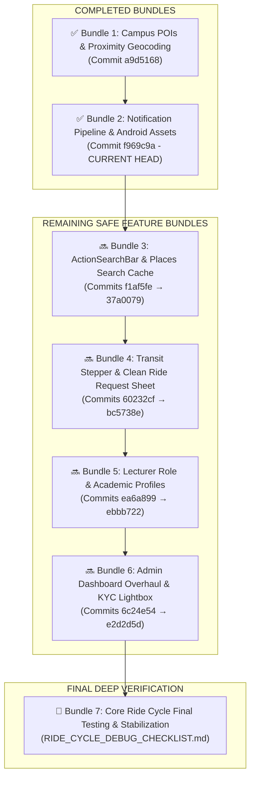

# 🗺️ STUDENT-RIDE: MASTER FEATURE MIGRATION ROADMAP

> **Branch Target**: Strictly `Mapbox-stable` (`origin/Mapbox-stable`)  
> **Workspace**: Strictly `C:\Users\Reaga\OneDrive\Documents\VS Codes\Projects\Mapbox stable`  
> **Baseline Commit**: `885a0b1` (*"perf(map): set camera flyTo speed 2x slower to smooth 4.8s glide"*)  
> **Engineering Rule**: Andrej Karpathy Guidelines (1. Think Before Coding, 2. Simplicity First, 3. Surgical Changes, 4. Goal-Driven Execution)

---

## 📌 MASTER PIPELINE OVERVIEW

---

## 🟢 PART 1: COMPLETED FEATURE BUNDLES

### ✅ Bundle 1: Campus POIs, Hostels & Proximity Geocoding
* **Status**: `COMPLETED` *(Merged as commit `a9d5168`)*
* **Scope**: Landmark GeoJSON data, hostel POI color-coded category palette, sub-millisecond reverse geocoding snapping.
* **Commits Included**:
  * `e7bd22b` – *Mapbox standard POI color palette, add Kafue hostel, fix Mweru hostel category*
  * `557020f` – *Remove rogue Kabwe hostel on campus and duplicate Kingdom Hall*
  * `5ca041b` – *Apply category-matching text colors for POI names with halo stroke*
  * `ea526f9` – *Render crisp white text and icons in dark mode*
  * `4ae566c` – *Proximity landmark snapping and clean address formatting*

---

### ✅ Bundle 2: Notification Pipeline & Android Silhouette Drawables
* **Status**: `COMPLETED (CURRENT HEAD: f969c9a)`
* **Scope**: Full VAPID web-push pipeline with auto-purging dead tokens, native FCM Android channels, hardware vibration signatures, and transparent white silhouette notification icons across all screen densities.
* **Commits Included**:
  * `7b61be1` – *Comprehensive notifications.md catalog covering push, alerts, and toasts*
  * `d0686ed` – *Notification architecture, channels, audio/vibration rules, and VAPID key pipeline*
  * `f5c34f6` – *Auto-purge 401/403 stale VAPID subscriptions*
  * `1721d05` – *Generate transparent silhouette notification icon (ic_stat_notification) & colors.xml*

---

## 🔜 PART 2: REMAINING FEATURE BUNDLES (IN EXECUTION ORDER)

---

### 📦 Bundle 3: ActionSearchBar & Places Search Cache
* **Status**: `REMAINING (NEXT)`
* **Scope**: Top right-expanding search pill on the Ride Request page, day/night frosted glass appearance, Maki map category icons, and 2-layer MongoDB places cache with visit boosting.
* **Commits Included**:
  * `f1af5fe` – *Integrate ExpandableSearchBar component on Ride Request page*
  * `1f96f8b` – *Remove mobile focus ring and ensure seamless background styling*
  * `2542777` – *Integrate ActionSearchBar with animated campus places dropdown*
  * `0dbb683` – *Right-expanding pill with X toggle, search icon, and Maki icons*
  * `0d54fd8` – *Day/Night frosted glass visibility, 2-layer MongoDB search cache*
  * `37a0079` – *Dark gray frosted glass appearance and slim internal scrollbar*

---

### 📦 Bundle 4: Transit Stepper & Clean Ride Request Bottom Sheet
* **Status**: `REMAINING`
* **Scope**: Removes the duplicate text search box from the bottom sheet in `RideRequestPage.jsx` and adds the sleek vertical 2-step transit nodes (Pickup with Row 1 GPS button, connecting line, Destination node) with locked sheet height.
* **Commits Included**:
  * `60232cf` – *Clean 2-step transit stepper with row 1 GPS button and stable bottom sheet height*
  * `564bd6d` – *Integrate 21st.dev Stepper into pickup and dropoff slots with 100% fixed height*
  * `37a004d` – *Refine transit stepper layout, align GPS button to Row 1, vibrant green styling*
  * `66eb6f5` – *Seamlessly connect stepper nodes with zero gap and natural spacing*
  * `bc5738e` – *Permanently lock RideRequestPage and transit stepper in AGENTS.md*

---

### 📦 Bundle 5: Lecturer Role & Academic Profiles
* **Status**: `REMAINING`
* **Scope**: Passenger Role selection (Student vs. Lecturer), Year of Study 1–5 pills, `AdminLecturersPage.jsx`, and targeted lecturer push notifications.
* **Commits Included**:
  * `ea6a899` – *Native tactile pill selectors for year/program, solid theme colors without glow*
  * `ebbb722` – *Add Lecturer role, Year of Study (1-5), retention archiving, and targeted push notifications*

---

### 📦 Bundle 6: Admin Dashboard Overhaul & KYC Document Lightbox
* **Status**: `REMAINING`
* **Scope**: Admin analytics dashboard, driver trip stats, user/driver edit modal, popular places hotspots card, and full-screen KYC document inspection lightbox.
* **Commits Included**:
  * `6c24e54` – *Complete overhaul of Admin Dashboard, Users, Drivers & Rides with instant caching, date filters, role switcher & Mapbox live map*
  * `1cac07e` – *Dynamic driver trip stats, full user/driver edit modal, expandable ride history, popular places hotspots card, and clear wallet button*
  * `85fa21f` – *Enlarged desktop modals with full word wrap, modern duotone icons everywhere, and auto-purging notification pipeline*
  * `7b84fec` – *Maximum full-screen viewport modal overlay with clean top-right close controls and unclipped layout*
  * `58af819` – *Driver KYC documents inspection, image preview modal, and robust avatar error fallbacks*
  * `4ffb526` – *Upgrade driver KYC document viewer to Bug Report lightbox style*
  * `e2d2d5d` – *Resolve document serving 401 auth gate, correct backend host URL, and add media resolver*

---

## 🚫 PART 3: STRICTLY ISOLATED COMMITS (RIDE CYCLE & MAP MUTATIONS)
*(These commits altered `trip_rebuilder.py`, `PlatformMap.jsx`, vehicle rendering, or the live ride state machines. They are strictly quarantined and will **never** be blindly merged.)*

| Commit | Summary / Description | Reason Quarantined |
| :--- | :--- | :--- |
| **`49ee6a9`** | Fixed & private pricing engine, Mapbox route manager | Mutated `PlatformMap.jsx` and pricing calculation models. |
| **`727804d`** | Chat messaging & PlatformMap POI embedding | Mutated `PlatformMap.jsx` landmark lifecycle. |
| **`891a080`** | Student route geometry fallback & Mapbox Directions API | Mutated route slicing in `trip_rebuilder.py` (caused straight-line/overshoot bug). |
| **`f597f2e`** | Driver simulation location broadcasting & 3D camera follow | Mutated location broadcasting and camera follow in `PlatformMap.jsx`. |
| **`bba1e7c`** | Accountant Dashboard & ride cycle alignment | Mutated core ride state machines and trip rebuilder queries. |
| **`d2031a9`** | Commission division calculation & ride_archived mapping | Mutated driver settlement states. |
| **`c016429`** | Route rendering persistence & hook cleanup | Mutated route persistence in `PlatformMap.jsx`. |
| **`42ab201`** | Vehicle setup pipeline & live role sync | Altered driver setup gates and optimistic UI locks. |
| **`996d75c`** | Driver setup bypass & KYC register gate | Altered driver auth state checks. |

---

## 🏁 PART 4: FINAL RIDE CYCLE TESTING & STABILIZATION
Once Bundles 3, 4, 5, and 6 are implemented and verified, full attention transfers to [`RIDE_CYCLE_DEBUG_CHECKLIST.md`](file:///C:/Users/Reaga/OneDrive/Documents/VS%20Codes/Projects/Mapbox%20stable/RIDE_CYCLE_DEBUG_CHECKLIST.md) for complete end-to-end testing of single and multi-passenger ride lifecycles, dynamic 60 FPS line erasing behind the vehicle, bidirectional cancellation, and rating modal flows.
