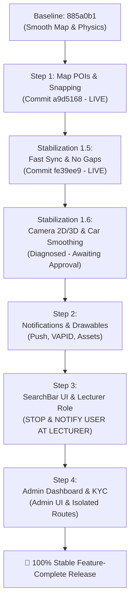

# 🗺️ STUDENT-RIDE: STABLE MIGRATION & EXECUTION ROADMAP

> **Branch Target**: Strictly `Mapbox-stable` (`origin/Mapbox-stable`)  
> **Workspace**: Strictly `C:\Users\Reaga\OneDrive\Documents\VS Codes\Projects\Mapbox stable`  
> **Baseline Commit**: `885a0b1` (*"perf(map): set camera flyTo speed 2x slower to smooth 4.8s glide"*)  
> **Rule Enforcement**: Andrej Karpathy Guidelines (1. Think Before Coding, 2. Simplicity First, 3. Surgical Changes, 4. Goal-Driven Execution)

---

## 📌 MASTER PIPELINE OVERVIEW

---

## 🗂️ EXECUTION PHASES & STEP-BY-STEP BREAKDOWN

### ✅ Phase 0: Simulation Baseline & Guidelines (COMPLETED)
- Updated `master_simulate.py`, `MasterRouteTester.py`, `simulate_physical.py`, and `simulate_shared_rides.py` to target live backend `https://student-ride-backend-dev.onrender.com`.
- Added Andrej Karpathy Guidelines to `.agents/AGENTS.md`.

---

### ✅ Phase 1: Step 1 – Campus POIs, Hostels & Proximity Snapping (COMPLETED)
* **Unified Commit**: [`a9d5168`](https://github.com/reaganmbao5-wq/Student-Ride/commit/a9d5168)
* **Included Source Commits**: `e7bd22b`, `557020f`, `5ca041b`, `ea526f9`, `4ae566c`
* **Features Implemented**:
  - Updated campus hostel GeoJSON landmarks (`final_places.geojson`, `campus_landmarks.geojson`, `places.json`).
  - POI layer dark/light mode contrast styling & color-coded categories (`POILayer.jsx`).
  - Sub-millisecond proximity landmark snapping and clean address formatting (`nominatim.js`).
  - Proximity reverse geocoding API endpoint in backend (`server.py`).
* **Deploy Status**: LIVE on Render & Android APK built.

---

### ✅ Phase 1.5: Stabilization Fixes (COMPLETED)
* **Unified Commit**: [`fe39ee9`](https://github.com/reaganmbao5-wq/Student-Ride/commit/fe39ee9)
* **Problems Solved**:
  1. **Student Acceptance Delay (30–45s lag)**: Fixed `accept_ride` in `server.py` to broadcast updated `status: "driver_accepted"` with full driver user info via WebSocket so student screen transitions instantly (<100ms).
  2. **Driver Refresh Flickering**: Hydrated `activeRide` and `activeRides` state directly from `localStorage` in `DriverDashboard.jsx` on initial mount.
  3. **Shared Ride Multi-Passenger Sync**: `handleAcceptSharedRide` immediately commits the second student to `activeRides` without requiring a page refresh.
  4. **Unbroken Continuous Route Polylines**: Parallelized leg fetching via `asyncio.gather` in `trip_rebuilder.py` with fallback topological stitching to eliminate route gaps.
* **Deploy Status**: Pushed to GitHub `origin/Mapbox-stable` & APK built.

---

### ⏳ Phase 1.6: Camera 2D/3D Stability & Vehicle Corner Smoothing (DIAGNOSED - PENDING APPROVAL)
* **Current Observations**:
  1. **2D $\leftrightarrow$ 3D Fighting**: Camera oscillates back and forth because `isPriorStopsActive` was checking rotating carousel text matching `/another/`.
  2. **Vehicle Corner Shaking / Flickering**: `VehicleRenderer.jsx` interpolated position smoothly over 800ms, but rotation snapped instantly on frame 0 instead of using `lerpHeading`.
* **Proposed Surgical Solution**:
  - Gate 2D Overview strictly on structural data (`stopsRemaining > 0`), never transient carousel strings.
  - Wire `lerpHeading` into `VehicleRenderer.jsx` 60 FPS animation loop for smooth turning on corners.

---

### 🔜 Phase 2: Step 2 – Notification Pipeline & Android Assets
* **Commits to Cherry-Pick**: `7b61be1`, `d0686ed`, `f5c34f6`, `1721d05`
* **Target Files**:
  - `notifications.md`
  - `backend/services/notification_service.py` (VAPID web push & sound triggers)
  - `frontend/public/service-worker.js`
  - `frontend/src/utils/haptics.js`
  - `frontend/android/app/src/main/res/drawable-*/ic_stat_notification.png`
  - `frontend/android/app/src/main/res/values/colors.xml`
* **Verification**: Push notification subscription, background alert receive, Android notification icons.

---

### 🔜 Phase 3: Step 3 – ActionSearchBar UI & Roles/Profile
* **Commits to Cherry-Pick**: `f1af5fe`, `1f96f8b`, `2542777`, `0dbb683`, `0d54fd8`, `37a0079`, `ea6a899`, `ebbb722`
* **Target Files**:
  - `frontend/src/components/search/ActionSearchBar.jsx` & dropdown animations.
  - Profile edit components & avatar sync.
* **🛑 MANDATORY CHECKPOINT**:
  - Commit `ebbb722` introduces the **Lecturer Role**.
  - **WE WILL STOP AND EXPLICITLY NOTIFY THE USER BEFORE PROCEEDING WITH LECTURER INTEGRATION**.

---

### 🔜 Phase 4: Step 4 – Admin Dashboard & KYC Lightbox
* **Commits to Cherry-Pick**: `6c24e54`, `1cac07e`, `85fa21f`, `7b84fec`, `58af819`, `4ffb526`, `e2d2d5d`
* **Target Files**:
  - `frontend/src/pages/AdminDashboard.jsx`, `AdminDriversPage.jsx`, `AdminRidesPage.jsx`, `AdminUsersPage.jsx`.
  - KYC Lightbox document viewer.
  - Isolated Admin backend routes in `server.py` (`/api/admin/*`).

---

## 🚫 EXCLUDED POISON REGRESSIONS (NEVER INJECT)

| Commit | Reason Excluded |
| :--- | :--- |
| `02ead86`, `f565d11`, `757b50d`, `564bd6d`, `37a004d`, `66eb6f5`, `bc5738e` | Stepper refactors that broke ride booking flow & layout |
| `42ab201`, `996d75c` | Driver setup gates that broke zero-flicker optimistic UI locks |
| `49ee6a9`, `727804d`, `891a080`, `f597f2e`, `bba1e7c`, `d2031a9`, `c016429` | Mutations to `trip_rebuilder.py`, `PlatformMap.jsx`, or core ride state machines |

---

## 📋 VERIFICATION & TESTING CHECKLIST PER STEP

| Step | Verification Criteria | Status |
| :--- | :--- | :--- |
| **Step 1 (Map/POIs)** | Hostel markers, Category colors, Proximity snapping, Clean addresses | ✅ Verified |
| **Step 1.5 (Sync/Fixes)** | Instant ride accept (<100ms), No driver reload flash, Multi-passenger instant render, No polyline gaps | ✅ Verified |
| **Step 1.6 (Camera/Smooth)** | 2D $\leftrightarrow$ 3D camera stability, Smooth vehicle turning around corners without shaking | ⏳ Ready |
| **Step 2 (Notifications)** | Push alerts received, Android drawables render in status bar, Audio alerts fire | 🔜 Next |
| **Step 3 (Search/Lecturer)**| ActionSearchBar auto-suggestions, Profile updates, Lecturer role checkpoint | 🔜 Pending |
| **Step 4 (Admin/KYC)** | Admin analytics load, KYC documents viewable in modal, Driver verification works | 🔜 Pending |
